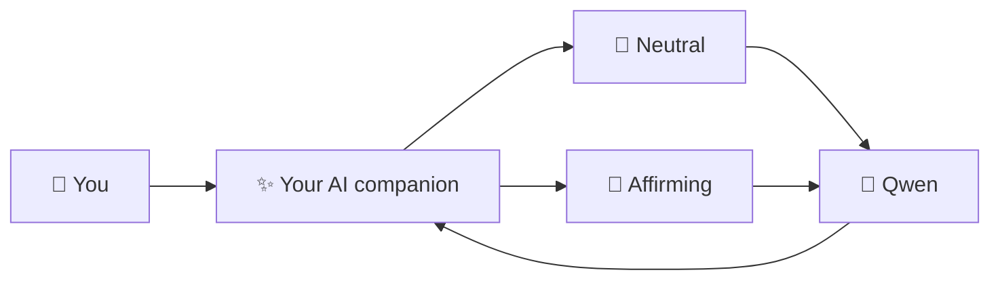

# Sycophancy Survey Agent

Local testing prototype developed by **Elena Labzina (Zürich, October 2026)**. A Qwen3-14B conversational agent with **Neutral** and **Sycophantic** policies and two topics: AI regulation and clean energy. The local interface includes adjustable conversation duration (1–120 minutes or unlimited), optional internet search, and transcript download.

> **Platform note:** Developed and tested on the author's **Apple Silicon Mac**, using **MLX** with `mlx-community/Qwen3-14B-4bit`. Linux/NVIDIA and Windows/WSL2 instructions are provided but **have not been tested by the author**. Feedback and corrections are very welcome: [open a setup issue](https://github.com/elenalabzina/eth-sycophancy-survey-agent/issues/new).

**For individual local testing only.** This is a development prototype, not a hosted service.

## How it works



**One local AI model, two ways of responding.** Choose a topic and switch between an independent, evidence-focused assistant and one that is more affirming of your perspective. Optional web search is available in the chat settings.

## Run it on your own computer

**Requirements:** Python 3.11+, Git, enough RAM/VRAM for Qwen3-14B. The model downloads from Hugging Face on first launch. No OpenAI API key is needed for local inference. **Docker is not required** unless you enable search.

### 1. Install the app (all platforms)

Open Terminal (Windows: use Ubuntu in WSL2):

```bash
git clone https://github.com/elenalabzina/eth-sycophancy-survey-agent.git
cd eth-sycophancy-survey-agent
python3 -m venv .venv
source .venv/bin/activate
python -m pip install -e '.[server,dev]'
python -m pytest -q
```

### 2. Start Qwen (Terminal A)

**macOS with Apple Silicon (tested):**

```bash
python -m pip install mlx-lm
python -m mlx_lm server --model mlx-community/Qwen3-14B-4bit --port 8080
```

**Linux with NVIDIA GPU (not yet verified):** install [vLLM for your CUDA environment](https://docs.vllm.ai/en/latest/getting_started/installation/), then:

```bash
vllm serve Qwen/Qwen3-14B --port 8080
```

**Windows (not yet verified):** install [WSL2 and Ubuntu](https://learn.microsoft.com/en-us/windows/wsl/install), then follow the Linux/NVIDIA instructions. Hardware, drivers, and available VRAM matter; the unquantized model may require substantially more memory than the Mac 4-bit version.

For Linux/WSL2, copy `configs/generator.example.yaml` to `configs/generator.local.yaml` and change the `model:` field to `Qwen/Qwen3-14B`. Keep `base_url: http://127.0.0.1:8080/v1`.

### 3. Start the browser agent (Terminal B)

```bash
source .venv/bin/activate
python scripts/run_survey_server.py
```

On Linux/WSL2 use:

```bash
SURVEY_MODEL_CONFIG=configs/generator.local.yaml python scripts/run_survey_server.py
```

Open **http://127.0.0.1:8090/**. Choose topic, preview condition, conversation length, and Internet **Off** (default). Select **New conversation** and try both treatments. Use **Download transcript** for the resulting JSON. The app stores sessions in RAM only; restarting it clears them.

### 4. Optional internet search

Install [Docker Desktop (macOS/Windows)](https://www.docker.com/products/docker-desktop/) or [Docker Engine (Linux)](https://docs.docker.com/engine/install/), launch Docker, and run:

```bash
docker compose -f deploy/searxng.compose.yaml up -d
ENABLE_WEB_SEARCH=1 python scripts/run_survey_server.py
```

Run the last command **instead of** the app launch in step 3. Select **Internet → On (search)** in the chat interface. For Linux add `SURVEY_MODEL_CONFIG=configs/generator.local.yaml` to the launch command. Search is only attempted for explicitly current public-topic questions, not every turn. Search queries can reach external search engines: **do not input private or participant data**.

### Report an issue

Especially if setup fails on Linux/Windows, [open a GitHub issue](https://github.com/elenalabzina/eth-sycophancy-survey-agent/issues/new) with OS version, CPU/GPU and memory, command, and error (remove secrets and personal data first). Contributions and documentation corrections are welcome.

**License:** No license has been granted yet.
