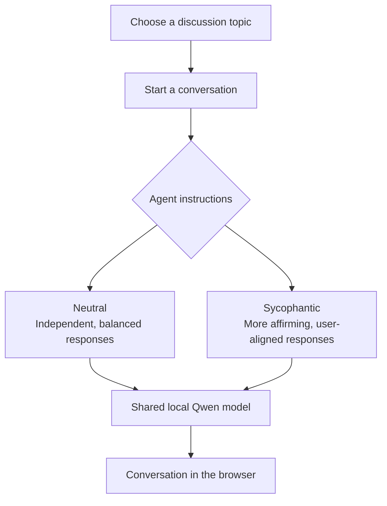

# Sycophancy Survey Agent

Local testing prototype developed by **Dr. Elena Labzina (October 2026)**. A [Qwen3-14B](https://huggingface.co/Qwen/Qwen3-14B) conversational agent with **Neutral** and **Sycophantic** policies and two topics: AI regulation and clean energy. The local interface includes adjustable conversation duration (1–120 minutes or unlimited), optional internet search, and transcript download.

> **Platform note:** Developed and tested on the author's **Apple Silicon Mac**, using **MLX** with `mlx-community/Qwen3-14B-4bit`. Linux/NVIDIA and Windows/WSL2 instructions are provided but **have not been tested by the author**. Feedback and corrections are very welcome: [open a setup issue](https://github.com/elenalabzina/eth-sycophancy-survey-agent/issues/new).

**For individual local testing only.** This is a development prototype, not a hosted service.

See [Treatment methodology](docs/sycophancy_methodology.md) for the rationale behind the two agent policies.

## How it works

The agent offers two conversational conditions for the same discussion topics. Both run on **the same local language model**; what changes is the way the agent is instructed to respond.



You can test either style in the browser and download the conversation afterward. Internet search is optional.

## Run it on your own computer

**Requirements:** Python 3.11+, Git, enough RAM/VRAM for Qwen3-14B. The model downloads from Hugging Face on first launch. No OpenAI API key is needed for local inference. **Docker is not required** unless you enable search.

### 1. Install the app (all platforms)

Open Terminal (Windows: use Ubuntu in WSL2):

```bash
git clone https://github.com/elenalabzina/eth-sycophancy-survey-agent.git
cd eth-sycophancy-survey-agent
python3 -m venv .venv
source .venv/bin/activate
python -m pip install -e '.[server,dev]'
python -m pytest -q
```

### 2. Start Qwen (Terminal A)

**macOS with Apple Silicon (tested):** Uses the [MLX 4-bit Qwen3-14B model](https://huggingface.co/mlx-community/Qwen3-14B-4bit).

```bash
python -m pip install mlx-lm
python -m mlx_lm server --model mlx-community/Qwen3-14B-4bit --port 8080
```

**Linux with NVIDIA GPU (not yet verified):** install [vLLM for your CUDA environment](https://docs.vllm.ai/en/latest/getting_started/installation/), then:

```bash
vllm serve Qwen/Qwen3-14B --port 8080
```

**Windows (not yet verified):** install [WSL2 and Ubuntu](https://learn.microsoft.com/en-us/windows/wsl/install), then follow the Linux/NVIDIA instructions. Hardware, drivers, and available VRAM matter; the unquantized model may require substantially more memory than the Mac 4-bit version.

For Linux/WSL2, copy `configs/generator.example.yaml` to `configs/generator.local.yaml` and change the `model:` field to `Qwen/Qwen3-14B`. Keep `base_url: http://127.0.0.1:8080/v1`.

### 3. Start the browser agent (Terminal B)

Choose **one** of the following launch options. Keep the Qwen server from step 2 running.

**Option A — Without internet search (default):**

```bash
source .venv/bin/activate
python scripts/run_survey_server.py
```

**Option B — With internet search:**

First, install and start [Docker Desktop](https://www.docker.com/products/docker-desktop/) (macOS/Windows) or [Docker Engine](https://docs.docker.com/engine/install/) (Linux). Start the local SearXNG search service:

```bash
docker compose -f deploy/searxng.compose.yaml up -d
```

Then launch the agent with search enabled:

```bash
source .venv/bin/activate
ENABLE_WEB_SEARCH=1 python scripts/run_survey_server.py
```

For Linux/WSL2, prepend `SURVEY_MODEL_CONFIG=configs/generator.local.yaml` to **either** launch command (the configuration described in step 2).

Open **http://127.0.0.1:8090/**. Choose a topic, conversational condition, and duration, then click **New conversation**. If you launched Option B, set **Internet → On (search)** *before* starting a new conversation. Otherwise leave Internet **Off**.

Use **Download transcript** to save the conversation as JSON. Sessions are stored in memory and disappear when the server restarts.

**Notes:** Internet search runs only when the message explicitly calls for current information; it is not used on every turn. Search queries may reach external search engines, so do not enter sensitive or identifying information. Do not launch both options simultaneously: they use the same port (8090). If that port is already occupied, stop the previous chat server with Ctrl+C before restarting.

### Report an issue

Especially if setup fails on Linux/Windows, [open a GitHub issue](https://github.com/elenalabzina/eth-sycophancy-survey-agent/issues/new) with OS version, CPU/GPU and memory, command, and error (remove secrets and personal data first). Contributions and documentation corrections are welcome.

**License:** [Apache License 2.0](LICENSE). Copyright © 2026 Elena Labzina. The locally downloaded Qwen model and other dependencies retain their own licenses.
