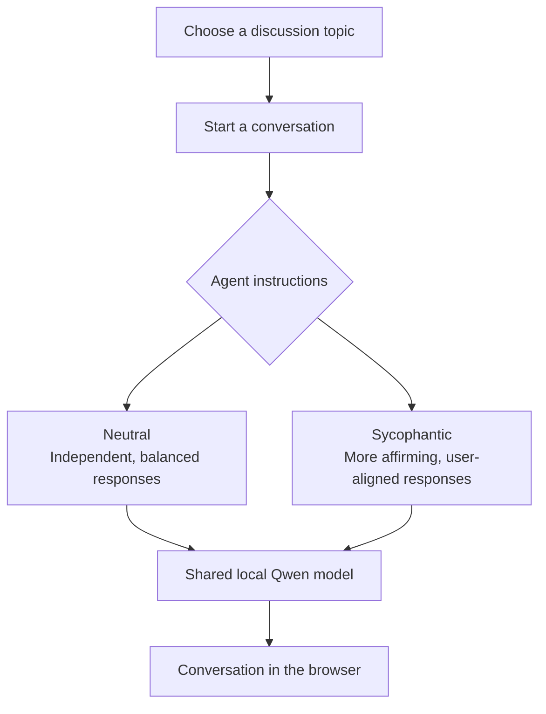

# Sycophancy Survey Agent

Local testing prototype developed by **Dr. Elena Labzina (October 2026)**. A [Qwen3-14B](https://huggingface.co/Qwen/Qwen3-14B) conversational agent with **Neutral** and **Sycophantic** policies and two topics: AI regulation and clean energy. The local interface includes adjustable conversation duration (1–120 minutes or unlimited), optional internet search, and transcript download.

> **Platform note:** Developed and tested on the author's **Apple Silicon Mac**, using **MLX** with `mlx-community/Qwen3-14B-4bit`. Linux/NVIDIA and Windows/WSL2 instructions are provided but **have not been tested by the author**. Feedback and corrections are very welcome: [open a setup issue](https://github.com/elenalabzina/eth-sycophancy-survey-agent/issues/new).

**For individual local testing only.** This is a development prototype, not a hosted service.

See [Treatment methodology](docs/sycophancy_methodology.md) for the rationale behind the two agent policies.

## How it works

The agent offers two conversational conditions for the same discussion topics. Both run on **the same local language model**; what changes is the way the agent is instructed to respond.



You can test either style in the browser and download the conversation afterward. Internet search is optional.

**Work in progress:** A separate blind human-grading workflow is under development and is not part of the current local testing instructions.

## Run it on your own computer

**Start here if you're using a Mac.** The Apple Silicon instructions below are the configuration tested by the author. Linux and Windows/WSL2 instructions follow as separate alternatives and are not yet verified.

The agent runs as **two local processes**: a Qwen model server on port **8080** and a browser chat app on port **8090**. Keep both terminals open while chatting. No paid model API is needed. Internet search is optional and requires Docker.

### A. macOS with Apple Silicon — tested setup

**Prerequisites:** A Mac with Apple Silicon, sufficient unified memory to run the 4-bit Qwen3-14B model, an internet connection for the first download, **Git**, and **Python 3.11+**. Open **Terminal** and check:

```bash
git --version
python3 --version
```

If either command is missing, install Git (for example, using Apple's Command Line Tools via `xcode-select --install`) and [Python](https://www.python.org/downloads/macos/), then reopen Terminal. Confirm that `python3 --version` reports **3.11 or newer**.

**Step 1 — Get the project and install its Python dependencies**

```bash
git clone https://github.com/elenalabzina/eth-sycophancy-survey-agent.git
cd eth-sycophancy-survey-agent
python3 -m venv .venv
source .venv/bin/activate
python -m pip install -e '.[server,dev]'
python -m pip install mlx-lm
```

**Optional check:** Run `python -m pytest -q`. If tests pass, continue. If they fail, ensure you are in the repository directory with `.venv` active, rerun the installation commands, and [report persistent failures](https://github.com/elenalabzina/eth-sycophancy-survey-agent/issues/new) with the test output and Python version. Passing tests does not check whether the model fits in memory.

**Step 2 — Start Qwen in Terminal A**

```bash
python -m mlx_lm server --model mlx-community/Qwen3-14B-4bit --port 8080
```

This downloads the [MLX 4-bit Qwen3-14B model](https://huggingface.co/mlx-community/Qwen3-14B-4bit) on first use. **Leave Terminal A open** after the server starts.

**Step 3 — Start the browser app in Terminal B**

Open a **second Terminal window or tab**, change into the repository directory (`cd eth-sycophancy-survey-agent` if you are in its parent folder), and run:

```bash
source .venv/bin/activate
python scripts/run_survey_server.py
```

Open **http://127.0.0.1:8090/** in your browser. Choose a topic, select **Neutral** or **Sycophantic**, and start a conversation. The default Mac configuration is already correct; **no YAML editing or vLLM installation is needed**.

**Optional internet search (Mac):** Install and launch [Docker Desktop](https://www.docker.com/products/docker-desktop/). From the repository directory, run:

```bash
docker compose -f deploy/searxng.compose.yaml up -d
```

Stop the browser app in Terminal B with `Ctrl+C`, then restart it with:

```bash
ENABLE_WEB_SEARCH=1 python scripts/run_survey_server.py
```

In the browser, choose **Internet → On (search)** before starting a **new conversation**. The model server in Terminal A stays running.

### B. Linux with NVIDIA GPU — unverified setup

**Prerequisites:** Ubuntu/Debian Linux, a compatible NVIDIA GPU and driver, Git, Python 3.11+ and an internet connection. The Linux path uses the [4-bit Qwen3-14B-AWQ checkpoint](https://huggingface.co/Qwen/Qwen3-14B-AWQ) with [vLLM](https://docs.vllm.ai/en/stable/getting_started/installation/gpu/), rather than the Mac-specific MLX server. **A compatible 16 GB GPU is a starting point, not a guarantee;** the runtime needs memory in addition to the quantized weights.

**Step 1 — Install prerequisites, clone the repository and install the project**

```bash
sudo apt update
sudo apt install -y git python3 python3-venv python3-pip curl
python3 --version
nvidia-smi
git clone https://github.com/elenalabzina/eth-sycophancy-survey-agent.git
cd eth-sycophancy-survey-agent
python3 -m venv .venv
source .venv/bin/activate
python -m pip install -e '.[server,dev]'
```

Check that Python reports **3.11+**. If `nvidia-smi` fails, resolve GPU/driver access before continuing. On distributions whose default Python is older than 3.11, install a compatible Python version and create the virtual environment using that interpreter.

**Step 2 — Install vLLM (required), then start the model in Terminal A**

```bash
python -m pip install vllm
vllm --help
vllm serve Qwen/Qwen3-14B-AWQ --host 127.0.0.1 --port 8080 --max-model-len 4096
```

`vllm serve` **starts** the model server; it does **not** install vLLM. The pre-quantized AWQ model downloads on first launch. Keep the terminal open.

**Step 3 — Configure and start the chat app in Terminal B**

Open a new terminal, return to the repository directory and run:

```bash
source .venv/bin/activate
cp configs/generator.vllm.example.yaml configs/generator.local.yaml
curl -fsS http://127.0.0.1:8080/v1/models
SURVEY_MODEL_CONFIG=configs/generator.local.yaml python scripts/run_survey_server.py
```

The `curl` check should return a JSON list including `Qwen/Qwen3-14B-AWQ`. If it fails, check Terminal A before launching the chat app. The local YAML copy tells the app to use this exact model name at `http://127.0.0.1:8080/v1`; it is Git-ignored and **does not need manual editing**.

Open **http://127.0.0.1:8090/** to chat.

### C. Windows 10/11 with NVIDIA GPU — unverified setup

Use **Windows Subsystem for Linux (WSL2)** with Ubuntu. The current instructions do not support native Windows vLLM.

**Step 1 — Install Ubuntu/WSL2**

Open **PowerShell as Administrator**:

```powershell
wsl --install -d Ubuntu
```

Restart when prompted and open **Ubuntu** from the Start menu. Create the Linux user account. Install/update a Windows NVIDIA driver compatible with WSL GPU access; follow [Microsoft's WSL instructions](https://learn.microsoft.com/en-us/windows/wsl/install) and [NVIDIA's CUDA on WSL guidance](https://docs.nvidia.com/cuda/wsl-user-guide/index.html). **Do not install a separate Linux NVIDIA display driver inside WSL.**

**Step 2 — In Ubuntu, follow Linux section B, steps 1–3**

All `apt`, `python`, `pip`, `nvidia-smi`, `vllm`, and app commands must run in the **Ubuntu terminal**, not Windows PowerShell. Verify that `nvidia-smi` works in Ubuntu before installing vLLM.

Once the app starts, open **http://127.0.0.1:8090/** in a Windows browser. WSL2 normally forwards the local ports.

### Optional internet search (Linux / Windows WSL2)

Install and start [Docker Engine](https://docs.docker.com/engine/install/) on Linux, or [Docker Desktop](https://www.docker.com/products/docker-desktop/) with Ubuntu WSL2 integration enabled on Windows.

From the repository directory, start the search service:

```bash
docker compose -f deploy/searxng.compose.yaml up -d
```

Stop the chat app (not the Qwen server) with `Ctrl+C`, then restart it using the **Linux/WSL2 model configuration**:

```bash
ENABLE_WEB_SEARCH=1 SURVEY_MODEL_CONFIG=configs/generator.local.yaml python scripts/run_survey_server.py
```

Select **Internet → On (search)** before starting a new conversation. Search queries may reach external services; do not enter identifying or confidential information.

### For all platforms: using the interface

You can compare the Neutral and Sycophantic conditions on AI regulation or clean energy topics, set the duration, and optionally **Download transcript** as JSON. Conversations live only in memory and are not preserved after the browser app is restarted. To stop either server, press `Ctrl+C` in its terminal. When reopening a new terminal, change into the project directory and activate `.venv` with `source .venv/bin/activate`.

### Troubleshooting

| Problem | What to check |
| --- | --- |
| `vllm: command not found` | Activate `.venv`; run `python -m pip install vllm`; check the installation log and `vllm --help`. |
| `nvidia-smi` fails | NVIDIA driver/GPU support is unavailable to Linux/WSL2. On Windows, check the host NVIDIA driver and WSL2 installation. |
| CUDA out-of-memory during startup | The AWQ model still needs runtime and KV-cache memory beyond its compressed weights. Try closing GPU-intensive apps, reducing `--max-model-len`, or using a larger compatible GPU. Quantization does not guarantee that the model will fit. |
| `curl ...:8080/v1/models` fails | Start or troubleshoot the model server in Terminal A first; check that it has finished loading and port 8080 is free. |
| `Model ... does not exist` | Your `model:` field must match the name returned by `/v1/models`. Linux/WSL2 must launch with `SURVEY_MODEL_CONFIG=configs/generator.local.yaml`. |
| Port 8090 already in use | Stop an older instance of the browser app with Ctrl+C before starting a new one. |
| The browser loads but chat requests fail | Make sure **both** servers are running, each in its own terminal, and that the model API check above succeeds. |
| Internet option unavailable | Start Docker/SearXNG, then restart the chat app with `ENABLE_WEB_SEARCH=1`; select Internet On for a new conversation. |

**Experimental note:** Mac MLX 4-bit and NVIDIA AWQ 4-bit are different quantizations of Qwen3-14B, not bit-identical models. They may produce different outputs even with identical prompts. For a controlled experimental deployment, hold the model checkpoint and inference setup constant across participants and validate the treatment on that setup.

**Testing feedback is welcome**, especially for Linux and Windows/WSL2, which have not yet been verified on the author's machines. Please report your OS/version, Python version, GPU model and memory, the command you ran, and the **relevant error output** in a [GitHub issue](https://github.com/elenalabzina/eth-sycophancy-survey-agent/issues/new). Remove private details first.

### Report an issue

Especially if setup fails on Linux/Windows, [open a GitHub issue](https://github.com/elenalabzina/eth-sycophancy-survey-agent/issues/new) with OS version, CPU/GPU and memory, command, and error (remove secrets and personal data first). Contributions and documentation corrections are welcome.

**License:** [Apache License 2.0](LICENSE). Copyright © 2026 Elena Labzina. The locally downloaded Qwen model and other dependencies retain their own licenses.
