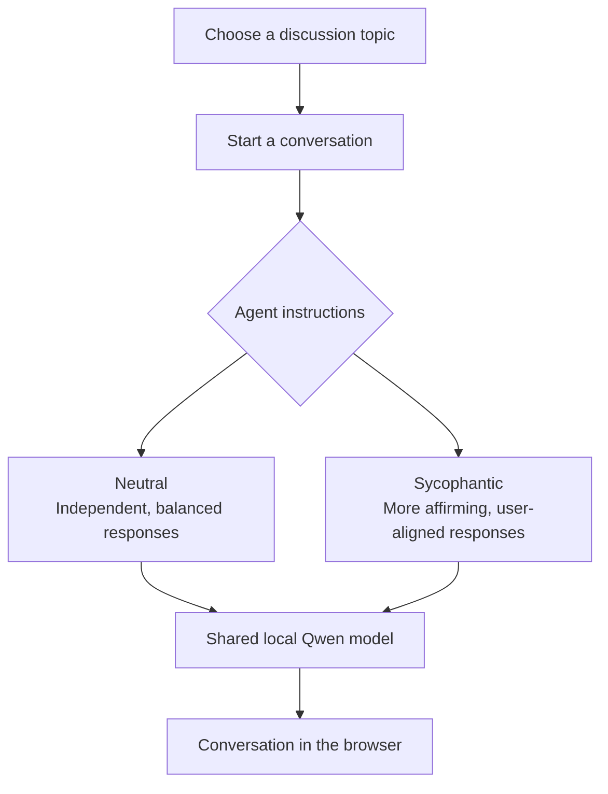

# Sycophancy Survey Agent

Local testing prototype developed by **Dr. Elena Labzina (October 2026)**. A [Qwen3-14B](https://huggingface.co/Qwen/Qwen3-14B) conversational agent with **Neutral** and **Sycophantic** policies and two topics: AI regulation and clean energy. The local interface includes adjustable conversation duration (1–120 minutes or unlimited), optional internet search, and transcript download.

> **Platform note:** Developed and tested on the author's **Apple Silicon Mac**, using **MLX** with `mlx-community/Qwen3-14B-4bit`. Linux/NVIDIA and Windows/WSL2 instructions are provided but **have not been tested by the author**. Feedback and corrections are very welcome: [open a setup issue](https://github.com/elenalabzina/eth-sycophancy-survey-agent/issues/new).

**For individual local testing only.** This is a development prototype, not a hosted service.

See [Treatment methodology](docs/sycophancy_methodology.md) for the rationale behind the two agent policies.

## How it works

The agent offers two conversational conditions for the same discussion topics. Both run on **the same local language model**; what changes is the way the agent is instructed to respond.



You can test either style in the browser and download the conversation afterward. Internet search is optional.

**Work in progress:** A separate blind human-grading workflow is under development and is not part of the current local testing instructions.

## Run it on your own computer

There are **two processes**, which must run at the same time:

1. **Model server** (Terminal A, port **8080**): runs Qwen3-14B. On Apple Silicon this uses MLX; on Linux/Windows with NVIDIA GPUs it uses vLLM with a 4-bit AWQ checkpoint.
2. **Browser chat app** (Terminal B, port **8090**): connects to the model server. It does **not** run or download the model by itself.

**Hardware:** Qwen3-14B is a large local model. Both the Mac/MLX version and the Linux/WSL2 vLLM version below use **4-bit quantized weights** (different formats: MLX versus AWQ). The AWQ weights need roughly 7–10 GB before runtime overhead; KV cache, context length, and serving overhead require additional VRAM. A compatible NVIDIA GPU with **16 GB or more VRAM is a reasonable starting point**, not a guarantee. Smaller GPUs may fail, and requirements vary with model settings and hardware. Check [vLLM's AWQ compatibility table](https://docs.vllm.ai/en/latest/features/quantization/) for your GPU generation. The Linux/WSL2 path requires an NVIDIA GPU with compatible drivers; alternative hardware is not covered here.

**Software:** Python 3.11+, Git, and an internet connection for first-time package/model downloads. No paid LLM API key is required. Docker is optional **only for web search**.

### 1. Install the project (all platforms)

**Linux (Ubuntu/Debian):** If Python, Git or virtual-environment support is missing, install them first:

```bash
sudo apt update
sudo apt install -y git python3 python3-venv python3-pip curl
```

**Windows 10/11:** These instructions use **Ubuntu inside WSL2**, not native Windows Python or PowerShell. First open **PowerShell as Administrator** and run:

```powershell
wsl --install -d Ubuntu
```

Restart Windows if prompted. Open **Ubuntu** from the Start menu and complete the first-run username/password setup. Run all subsequent Linux commands **inside the Ubuntu terminal**. For installation guidance see [Microsoft's WSL documentation](https://learn.microsoft.com/en-us/windows/wsl/install). You will also need an NVIDIA Windows driver that supports CUDA in WSL; see [NVIDIA's CUDA on WSL guide](https://docs.nvidia.com/cuda/wsl-user-guide/index.html). **Do not install a separate Linux NVIDIA display driver inside WSL.**

**macOS:** Open Terminal and make sure Python 3.11+ and Git are installed.

Now, on any platform (**Ubuntu terminal on Windows**), clone the repository and install the project:

```bash
git clone https://github.com/elenalabzina/eth-sycophancy-survey-agent.git
cd eth-sycophancy-survey-agent
python3 -m venv .venv
source .venv/bin/activate
python -m pip install -e '.[server,dev]'
```

The `.venv` directory is a private Python environment for this project. When you open a **new terminal**, return to the repository directory and run `source .venv/bin/activate` again.

**Optional installation check (recommended):**

```bash
python -m pytest -q
```

- **Tests pass:** Continue. This checks the project code, **not** whether the model fits on your GPU.
- **Tests fail:** Confirm that you're inside the project directory, activate `.venv`, then rerun `python -m pip install -e '.[server,dev]'` and `python -m pytest -q`. If it still fails, [file an issue](https://github.com/elenalabzina/eth-sycophancy-survey-agent/issues/new) with the error output and your OS/Python version. Do not include secrets or personal data.

### 2. Install and start Qwen (Terminal A)

Choose **one** path below according to your computer. Keep this terminal open once the model server starts.

#### macOS with Apple Silicon — tested

Uses the [4-bit MLX model](https://huggingface.co/mlx-community/Qwen3-14B-4bit), which downloads automatically on first use.

```bash
source .venv/bin/activate
python -m pip install mlx-lm
python -m mlx_lm server --model mlx-community/Qwen3-14B-4bit --port 8080
```

The default config `configs/generator.example.yaml` already matches this model; **no configuration change is needed on Mac**.

#### Linux with NVIDIA GPU (4-bit AWQ) — not yet verified

**Yes, you must install vLLM before running `vllm serve`.** vLLM is the local model-serving program; `serve` starts an OpenAI-compatible HTTP server. It does not install anything.

First check that Linux can see your NVIDIA GPU:

```bash
nvidia-smi
```

If this command fails, fix your GPU driver/CUDA setup before proceeding. See [vLLM's official GPU installation guide](https://docs.vllm.ai/en/stable/getting_started/installation/gpu/) for compatibility and alternative installation methods.

Install vLLM **inside the activated project environment**:

```bash
source .venv/bin/activate
python -m pip install vllm
vllm --help
```

Then start the [official Qwen3-14B-AWQ 4-bit model](https://huggingface.co/Qwen/Qwen3-14B-AWQ) on local port 8080:

```bash
vllm serve Qwen/Qwen3-14B-AWQ --host 127.0.0.1 --port 8080 --max-model-len 4096
```

The checkpoint is **already quantized**: you do not need to run a quantization script or add `--quantization` manually. The `--max-model-len 4096` setting limits context length to reduce memory use for testing; increase it only if your GPU has spare capacity. The first launch downloads the model from Hugging Face. Leave this terminal running. If vLLM reports CUDA, memory, or dependency errors, consult the [official vLLM documentation](https://docs.vllm.ai/en/stable/getting_started/quickstart/) and include the error in your testing feedback.

#### Windows with NVIDIA GPU (WSL2 Ubuntu) — not yet verified

After completing the **Windows/WSL2 installation in step 1**, open the **Ubuntu** terminal, change into the cloned repository directory, and follow the **Linux with NVIDIA GPU** commands immediately above (`nvidia-smi`, install vLLM, `vllm serve`).

All Python, `vllm`, and project commands must run **inside WSL2 Ubuntu**, not PowerShell. Your NVIDIA GPU should appear when running `nvidia-smi` inside Ubuntu; if it does not, verify WSL2 and the host Windows NVIDIA driver before proceeding. Native Windows installation of vLLM is **not** supported by this setup.

### 3. Configure the chat app to use your model (Linux / WSL2 only)

**Why is this step needed?** The project's default YAML configuration points to the **Mac/MLX** version of Qwen. On Linux/WSL2, vLLM serves the quantized checkpoint under the name `Qwen/Qwen3-14B-AWQ`. The browser app must request **that exact name**.

In the repo directory, create a personal config from the ready-made Linux example:

```bash
cp configs/generator.vllm.example.yaml configs/generator.local.yaml
```

You **do not need to edit it** for the commands above. Its important fields are:

```yaml
model: Qwen/Qwen3-14B-AWQ
base_url: http://127.0.0.1:8080/v1
```

- `model` tells the chat app which model name to request from vLLM.
- `base_url` tells it where to reach vLLM's **local** OpenAI-compatible API; this is **not** an external paid service.
- `configs/generator.local.yaml` is ignored by Git, so personal settings are not committed.

**Check that the model server is reachable:** In a **new** Ubuntu/Linux terminal, from the project directory, run:

```bash
curl -fsS http://127.0.0.1:8080/v1/models
```

You should see JSON listing `Qwen/Qwen3-14B-AWQ`. If the request fails, the model server in Terminal A is not ready or did not start successfully. On Mac, the same check should show the MLX model name.

### 4. Start the browser chat (Terminal B)

Open **another terminal** in the repository directory. Keep Terminal A (the model server) running.

**macOS, without internet search (default):**

```bash
source .venv/bin/activate
python scripts/run_survey_server.py
```

**Linux / Windows WSL2, without internet search:**

```bash
source .venv/bin/activate
SURVEY_MODEL_CONFIG=configs/generator.local.yaml python scripts/run_survey_server.py
```

**Optional internet search on any platform:** Install and start [Docker Desktop](https://www.docker.com/products/docker-desktop/) (Mac/Windows) or [Docker Engine](https://docs.docker.com/engine/install/) (Linux). On Windows, enable Docker Desktop's WSL2 integration for Ubuntu. Start the local SearXNG service from the repository root:

```bash
docker compose -f deploy/searxng.compose.yaml up -d
```

Then use **one** of these app launch commands instead of the corresponding no-search command:

Mac:
```bash
ENABLE_WEB_SEARCH=1 python scripts/run_survey_server.py
```

Linux / Windows WSL2:
```bash
ENABLE_WEB_SEARCH=1 SURVEY_MODEL_CONFIG=configs/generator.local.yaml python scripts/run_survey_server.py
```

Open **http://127.0.0.1:8090/** in a browser. On Windows, try the normal Windows browser; WSL2 normally forwards localhost ports. If using internet search, choose **Internet → On (search)** *before* starting a new conversation. Otherwise keep Internet **Off**.

Choose the topic, condition (Neutral/Sycophantic), and duration; click **New conversation**. Use **Download transcript** if you want to keep a JSON copy. Sessions are stored in memory and are lost when the app restarts. Web search runs only for explicitly current-information requests; searches may reach third-party engines, so avoid private identifying data.

### Troubleshooting

| Problem | What to check |
| --- | --- |
| `vllm: command not found` | Activate `.venv`; run `python -m pip install vllm`; check the installation log and `vllm --help`. |
| `nvidia-smi` fails | NVIDIA driver/GPU support is unavailable to Linux/WSL2. On Windows, check the host NVIDIA driver and WSL2 installation. |
| CUDA out-of-memory during startup | The AWQ model still needs runtime and KV-cache memory beyond its compressed weights. Try closing GPU-intensive apps, reducing `--max-model-len`, or using a larger compatible GPU. Quantization does not guarantee that the model will fit. |
| `curl ...:8080/v1/models` fails | Start or troubleshoot the model server in Terminal A first; check that it has finished loading and port 8080 is free. |
| `Model ... does not exist` | Your `model:` field must match the name returned by `/v1/models`. Linux/WSL2 must launch with `SURVEY_MODEL_CONFIG=configs/generator.local.yaml`. |
| Port 8090 already in use | Stop an older instance of the browser app with Ctrl+C before starting a new one. |
| The browser loads but chat requests fail | Make sure **both** servers are running, each in its own terminal, and that the model API check above succeeds. |
| Internet option unavailable | Start Docker/SearXNG, then restart the chat app with `ENABLE_WEB_SEARCH=1`; select Internet On for a new conversation. |

**Experimental note:** Mac MLX 4-bit and NVIDIA AWQ 4-bit are different quantizations of Qwen3-14B, not bit-identical models. They may produce different outputs even with identical prompts. For a controlled experimental deployment, hold the model checkpoint and inference setup constant across participants and validate the treatment on that setup.

**Testing feedback is welcome**, especially for Linux and Windows/WSL2, which have not yet been verified on the author's machines. Please report your OS/version, Python version, GPU model and memory, the command you ran, and the **relevant error output** in a [GitHub issue](https://github.com/elenalabzina/eth-sycophancy-survey-agent/issues/new). Remove private details first.

### Report an issue

Especially if setup fails on Linux/Windows, [open a GitHub issue](https://github.com/elenalabzina/eth-sycophancy-survey-agent/issues/new) with OS version, CPU/GPU and memory, command, and error (remove secrets and personal data first). Contributions and documentation corrections are welcome.

**License:** [Apache License 2.0](LICENSE). Copyright © 2026 Elena Labzina. The locally downloaded Qwen model and other dependencies retain their own licenses.
